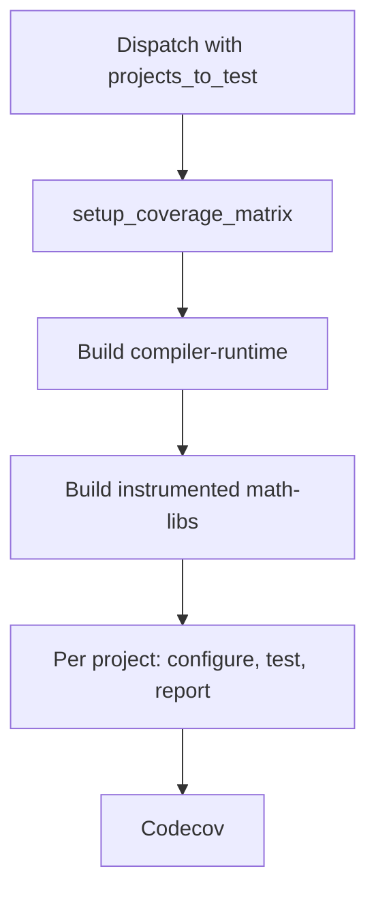

# Code Coverage

TheRock can build ROCm libraries with LLVM source-based coverage
instrumentation. Coverage is opt-in per project — instrumentation slows a
library substantially, and a report is only worth producing when the test suite
gives a meaningful signal.

## Enabling coverage for a local build

```bash
cmake -B build -GNinja . \
  -DTHEROCK_AMDGPU_FAMILIES=gfx94X-dcgpu \
  -DHIPDNN_ENABLE_COVERAGE=ON
```

TheRock passes `-D<PROJECT>_ENABLE_COVERAGE` to the matching subproject
unchanged. `<PROJECT>` is the subproject name in upper case: `hipDNN` reads
`HIPDNN_ENABLE_COVERAGE`. The subproject implements the option itself; TheRock
adds no compiler or linker flags. A subproject that doesn't read the option
builds uninstrumented, and CMake reports the variable as unused at the end of
that subproject's configure.

A subproject that still uses a legacy option name, such as
`BUILD_CODE_COVERAGE`, can be instrumented through its per-subproject arguments:

```bash
  -DhipRAND_CMAKE_ARGS=-DBUILD_CODE_COVERAGE=ON
```

### Test subprojects

`hipCCL_tests` is built from hipCCL's source, so it reads
`HIPCCL_ENABLE_COVERAGE`, not `HIPCCL_TESTS_ENABLE_COVERAGE`. The prim libraries
are header-only, so their coverage comes from the tests build. Pass hipCCL's
option to it directly:

```bash
  -DHIPCCL_ENABLE_COVERAGE=ON \
  -DhipCCL_tests_CMAKE_ARGS=-DHIPCCL_ENABLE_COVERAGE=ON
```

With `-DTHEROCK_FLAG_BUILD_HIPCCL=OFF`, the same applies to `rocPRIM_tests` and
`ROCPRIM_ENABLE_COVERAGE`.

### Enabling a whole group

| Option                                | Instruments                                                   |
| ------------------------------------- | ------------------------------------------------------------- |
| `THEROCK_COVERAGE_ROCM_LIBRARIES_ALL` | the subprojects in `THEROCK_COVERAGE_ROCM_LIBRARIES_PROJECTS` |
| `THEROCK_COVERAGE_ROCM_SYSTEMS_ALL`   | the subprojects in `THEROCK_COVERAGE_ROCM_SYSTEMS_PROJECTS`   |
| `THEROCK_COVERAGE_ALL`                | both of the above                                             |

Both lists are in the top-level `CMakeLists.txt`. Each group option sets
`<PROJECT>_ENABLE_COVERAGE=ON` for the subprojects in its list. An explicit
`-D<PROJECT>_ENABLE_COVERAGE=OFF` wins over a group option. These options
default to `OFF` and have no effect on a normal build. Test subprojects are not
in the lists, so pass their arguments as shown above.

## What a project's coverage option must do

TheRock passes only the flag, so `<PROJECT>_ENABLE_COVERAGE` must be complete in
the project itself:

- **LLVM source-based coverage** (`-fprofile-instr-generate -fcoverage-mapping`),
  not gcov. gcov writes `.gcda` files rather than the `.profraw` files the
  coverage tooling merges.
- **Host code only.** For HIP sources, qualify the flags with `-Xarch_host`.
  Otherwise the HIP driver forwards them to device compilation: the runtime
  aborts looking up missing profiling symbols in the device image, and when
  readback succeeds it writes a profile named after the device target (colons
  included, which breaks CI artifact upload).
- **The profile runtime's link dependencies.** `libclang_rt.profile_rocm.a`
  needs `-ldl` and `-lpthread`, which the driver does not supply. On the
  manylinux base these are not in libc, so an instrumented shared library gets
  undefined references and any executable linking it fails
  `--no-allow-shlib-undefined`. Link `${CMAKE_DL_LIBS}` and `Threads::Threads`
  when coverage is on.

## Producing a report locally

Set `LLVM_PROFILE_FILE` with `%p`/`%m` substitutions to keep per-process files
distinct, run the tests, then call `merge_coverage_report.py`:

```bash
export LLVM_PROFILE_FILE="$PWD/coverage-report/profraw/%p-%m.profraw"
ctest --test-dir build/ml-libs/hipDNN/build

python build_tools/github_actions/merge_coverage_report.py \
  --profraw-dir coverage-report/profraw \
  --rocm-dir build/dist/rocm \
  --object-globs "lib/libhipdnn_backend.so*" \
  --summary-output coverage-report/coverage_summary.txt \
  --html-output coverage-report/html
```

`llvm-profdata` and `llvm-cov` must match the compiler that built the objects;
the script uses the copies under `<rocm-dir>/lib/llvm/bin` (or
`--llvm-bin-dir`), falling back to `PATH` with a warning. Only the HTML reads
source files; lcov and the text table work from coverage mappings alone. Use
`--path-equivalence <from>,<to>` if the source tree has moved since the build.

## Coverage CI



`multi_arch_ci_coverage_linux.yml` is the entry point: it computes the matrix,
builds the instrumented stack, then fans out to
`multi_arch_ci_coverage_report.yml` per project per GPU family.
`COVERAGE_PROJECTS` in `build_tools/github_actions/configure_coverage_ci.py`
lists the projects it runs for: the CMake options that instrument each one, its
test component, the binaries its report covers, and its Codecov flag.

### Dispatching a run

Start from the Actions tab or `gh` CLI, or let the rocm-libraries nightly
call it via a cross-repo reusable `uses:` workflow call. There is no cron trigger.

Pass a recent nightly run id as `baseline_run_id` (keep `baseline_release_type`
at `nightly`) and set `projects_to_test`; other inputs use sensible defaults.
Leave `baseline_run_id` empty to test this run's own instrumented stack end to
end. Running coverage separately keeps failures off the nightly's status.
Automatic nightly dispatch is a follow-up; `baseline_run_id` is already the
right input.

Nightly runs set `nightly`, following phase 1 of the nightly plan in
[RFC0014](../rfcs/RFC0014-Code-Coverage-Infrastructure.md): build the whole
instrumented stack once. It adds all three group options
(`-DTHEROCK_COVERAGE_ROCM_LIBRARIES_ALL=ON`,
`-DTHEROCK_COVERAGE_ROCM_SYSTEMS_ALL=ON` and `-DTHEROCK_COVERAGE_ALL=ON`) to
`coverage_cmake_options`, so every listed project that implements its option is
instrumented. Reports still cover only `projects_to_test`. The workflow builds
only compiler-runtime and math-libs, so the rocm-systems projects, which build
in comm-libs, are not instrumented yet.

### The instrumented build

`setup_coverage_matrix` runs `configure_coverage_ci.py`, emitting the matrix
and `coverage_cmake_options`. A selection naming a project that is not in
`COVERAGE_PROJECTS` fails immediately.

`build_compiler_runtime` always runs first — every other stage pulls its
inbound artifacts from it. It is a regular, non-instrumented build.
`build_instrumented_math_libs` fans out over GPU families. Report jobs wait for
the whole fan-out, so with several families one failed build skips every
family's report; the default is a single family until multi-arch lands.

`coverage_cmake_options` holds the selected projects' CMake options, such as
`-DHIPDNN_ENABLE_COVERAGE=ON`, plus the group options in nightly mode. It is
passed to the math-libs build's `extra_cmake_options` input, which appends it
to that stage's configure line only; TheRock then passes each option to its
subproject as described in
[Enabling coverage for a local build](#enabling-coverage-for-a-local-build).
Outside nightly mode, everything not selected builds normally. Artifacts
publish under `release_type: ci`.

### Test execution

Per shard, `test_code_coverage_component.yml` does three things:

1. **Install baseline + swap project.** `install_rocm_code_coverage_build.py`
   installs from `--run-id` (the nightly) and replaces only the
   project under test from `--code-coverage-run-id`.
1. **Set `LLVM_PROFILE_FILE`** to a per-shard path (`%p`/`%m`) so concurrent
   processes don't overwrite each other.
1. **Run tests and upload profraw** under `always()` — a failing shard still
   exercised code.

Coverage runs use each component's normal `timeout_minutes` from
`fetch_test_configurations.py`; nothing extends it for instrumented builds.
Instrumented tests run slower, so a component close to its limit may time out.

#### Why there are two run ids

All selected projects are instrumented in one build, but each report must cover
one project. Each test job therefore installs a regular, uninstrumented
baseline and swaps in only the project under test, so no other instrumented
project writes profiles into its report.

The baseline is read from `baseline_release_type` (normally `nightly`), not the
coverage run's `ci` channel — artifacts are bucketed per channel. The swap
downloads the project's whole artifact but extracts only the paths matching the
project's library folder in `COMPONENT_MAP`. The two runs write to separate S3
paths; no files collide. With an empty `baseline_run_id`, both installs read
this run's `ci` artifacts, so every selected project is instrumented in every
test job.

A missing instrumented artifact fails the install step. A swap that matches no
files does not: the installer logs `Replaced 0` and the tests run against the
baseline's uninstrumented binaries. The failure then surfaces in the report
job, which finds no profraw files.

#### What scopes a report to one project

`object_globs` limits what `llvm-cov` reports on. The swap limits what is
instrumented: inline and template code is `linkonce_odr` and lands in every
binary that uses it — an instrumented sibling writes counters that
`llvm-profdata` merges in, unreachable by any `-object` filter. This matters
most for header-only libraries such as rocPRIM.

### Artifacts

| Artifact     | Where                               | Purpose                       |
| ------------ | ----------------------------------- | ----------------------------- |
| Instrumented | CI bucket, this run                 | Stack under test + LLVM tools |
| Profraw      | GitHub Actions artifacts, per shard | Raw profiles for aggregation  |

Profraw names include the project, GPU family, and shard index.

### Report generation

`aggregate_coverage` runs under `if: !cancelled()` so partial reports survive
shard failures. It downloads profraw artifacts, reinstalls the run's artifacts
(LLVM tools must match the compiler that produced the profiles), then runs
`merge_coverage_report.py`. Two conditions are fatal: no profraw files (tests
didn't run or the wrong library was loaded) and no matching objects
(`object_globs` doesn't match the project's install layout).

The `coverage-report-<project>-<family>` artifact:

| File                   | What it is                 |
| ---------------------- | -------------------------- |
| `coverage.info`        | lcov for Codecov           |
| `coverage_summary.txt` | per-file table with totals |
| `html/index.html`      | browsable annotated report |

Totals are also written to the job summary page. The HTML step runs
`fetch_sources.py` and remaps paths with `--path-equivalence`; it is
`continue-on-error` (losing it costs only the annotated view). Codecov is
skipped, not failed, when `CODECOV_TOKEN` is absent, and an upload error doesn't
fail the job either; both leave a warning on the run.

## Selecting projects to run

`projects_to_test` takes comma-separated names from `COVERAGE_PROJECTS`,
case-insensitive. Empty selects all of them. Only `hipdnn` is listed so far;
see [Adding a project](#adding-a-project).

## Adding a project

1. Implement `<PROJECT>_ENABLE_COVERAGE` upstream as described above. Keep the
   project's old option name as a deprecated alias for a while.
1. Bump the submodule in TheRock.
1. Add the subproject to `THEROCK_COVERAGE_ROCM_LIBRARIES_PROJECTS` or
   `THEROCK_COVERAGE_ROCM_SYSTEMS_PROJECTS` in `CMakeLists.txt`.
1. Verify that a local instrumented build produces a non-empty report; see
   [Producing a report locally](#producing-a-report-locally).
1. To run it in coverage CI, add it to `COVERAGE_PROJECTS` in
   `build_tools/github_actions/configure_coverage_ci.py`. `object_globs` must
   match what the project actually installs — a miss fails the report job
   rather than publishing zero.

## Blocked projects

These are left out of the group lists because their instrumented builds fail.

`hipBLASLt` — its coverage branch links against bare `rocroller` while the rest
of its CMakeLists uses `roc::rocroller`. Under TheRock rocRoller is a separate
subproject; the bare name reaches the linker as `-lrocroller` with no `-L`.

`hipTensor` — upstream applies coverage as a blanket `add_compile_options` on a
composable_kernel-based library. The coverage mapping data exceeds 2GB, failing
the link with out-of-range `R_X86_64_PC32` relocations. A larger code model is
the likely fix.

## Adding a stage

Coverage CI builds only `compiler-runtime` and `math-libs`, so every project in
`COVERAGE_PROJECTS` must be in `math-libs`; a unit test checks this. Covering a
project from another stage, such as `rccl` in `comm-libs`, needs a build job for
that stage in `multi_arch_ci_coverage_linux.yml` that also receives
`coverage_cmake_options`. A stage needs its inbound artifacts built first: check
its `artifact_group_deps` in `BUILD_TOPOLOGY.toml`, since a missing inbound
artifact won't surface until deep in the build.
