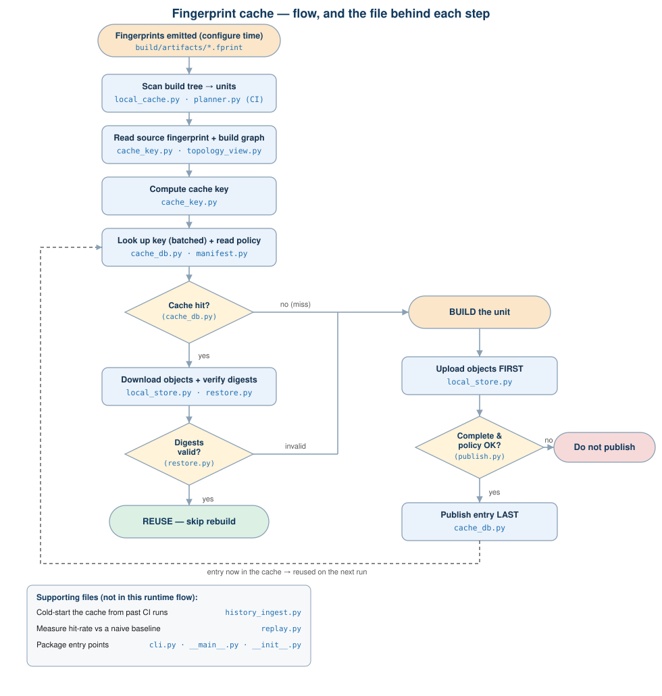

# Fingerprint-Based CI Artifact Cache

Replace the "baseline run" stage-reuse mechanism with a content-addressed artifact
cache keyed on `THEROCK_FPRINT`. Each run computes a cache key per artifact,
resolves hits in one batched database lookup, verifies object integrity, and
reuses prebuilt artifacts instead of rebuilding. No GitHub-API history traversal,
no git-history heuristics. Tracks [#8651](https://github.com/ROCm/TheRock/issues/8651)
(parent [#3399](https://github.com/ROCm/TheRock/issues/3399)).

## Problem

Reuse today selects a baseline workflow run by **commit ancestry + S3
archive-filename presence + job health** (`build_tools/github_actions/baseline_runs.py`,
`stage_reuse_decision.py`); fingerprints are never used. This is O(N) over workflow
runs, costs many API calls, cannot express rocm-libraries → rocm-libraries
dependencies or arbitrary build-graph subsets, and is fragile on release branches
([#8454](https://github.com/ROCm/TheRock/issues/8454)).

`THEROCK_FPRINT` (configure-time, per artifact) already hashes source identity,
dependency fingerprints, toolchain, and build flags. We use it as the cache key.

## Goals

- O(1)-style, batched key lookup, independent of workflow-history length.
- Reuse unchanged artifacts across pin updates and component commits; invalidate on
  recipe/environment changes.
- Integrity-verified reuse; unavailable/ineligible cache always falls back to build.
- Works on non-default/release branches; composes with RFC0013 test selection.

## Non-goals

- Test selection — stays [RFC0013](./RFC0013-Consumer-Based-Test-Selection.md);
  a cache hit never suppresses a test.
- Replacing `ccache` (compiler-call cache; complementary, stacks with this).
- New storage — reuse existing `ci-artifacts` S3 buckets as object storage; store
  pointers, not copies.

## Design

### Cache key

```
cache_key = e{EPOCH}:{SHA256(source_fingerprint, recipe_inputs, output_identity)}
```

| Input | In `THEROCK_FPRINT` | Action |
| --- | --- | --- |
| Subproject source identity (project-scoped git tree + extra inputs; invalid if dirty) | yes | keep — computation refined in RFC0017 ([#9732](https://github.com/ROCm/TheRock/pull/9732)) |
| Dependency fingerprints | yes | keep |
| Toolchain file | yes | keep |
| Build flags (incl. build variant, e.g. release/ASan) | yes | keep — already in the fingerprint; no separate key term |
| Output identity (`name`, `component`, `target`) | partial | **add** — see *Targets vs. target families* below |
| Container/image digest | no | **add** |
| Compiler id + version | indirect | add |
| `CACHE_EPOCH` (global) | n/a | keep — bump to invalidate the whole cache |

Key composition is isolated in one function so `source_fingerprint` is the only term
that changes when real uploaded fingerprints replace the PoC stand-in.

**Targets vs. target families.** Multi-arch CI builds a target *family* (e.g.
`gfx110X-all`), which expands to individual *targets* (`gfx1100`, `gfx1101`,
`gfx1102`, `gfx1103`). Split artifacts are emitted and named **per target** —
`fft_lib_gfx1100.tar.zst`, not per family — so the key's output identity must
distinguish targets, not families. This term is only load-bearing while split
artifacts share one source fingerprint; once each per-target artifact emits its
own `.fprint` (Required change 1), the fingerprint already differs per target and
folding the target into the key becomes a redundant safeguard rather than a
requirement. Build variant (release/ASan/...) is already captured by the CMake
flags in `THEROCK_FPRINT`, so it is not a separate key term.

### Cache value (manifest)

```
cache_key -> Manifest {
  artifact: (name, component, target)
  outputs:  [ {key, uri->S3 pointer, digest sha256, size} ]
  provenance: {repository, run_id, branch, commit, workflow, created_at}
  build_variant, dep_identities
  trust:       trusted | untrusted
  validation:  unvalidated | build_passed | tests_passed
  publication: pending | published | revoked
}
```

A **read policy** filters at lookup time (default: `trusted` + `build_passed` +
`published`). `trust` = push/schedule on a protected branch vs. pull_request (PR
entries are stored but tagged, so PRs cannot poison shared reuse). `publication`
enforces write ordering (readers trust only `published`).

### Flows



1. **Plan** (per run): changed paths → required artifact units per build stage →
   compute keys → one batched `WHERE cache_key IN (...)` lookup → a stage is
   skippable iff every required unit is a hit; otherwise only missing units build.
   Source-changed units are forced misses.
2. **Restore** (per unit): lookup under read policy → check completeness → download
   objects → re-verify digests → reusable / needs-build. A hit with missing or
   corrupt objects is downgraded to a build (defends against DB/storage drift).
3. **Publish** (per built unit): gate on outputs-complete + producer policy →
   upload objects first → publish manifest + fingerprint entry last.

### Index and storage

Objects stay in the existing S3 buckets (the index holds pointers; entries are
evictable when objects are retention-deleted). The `fingerprint -> artifact
location` index sits behind one interface and starts as simply as possible,
growing only as it must:

- **Static, checked-in JSON** (`build_tools/artifact_cache_index.json`) is the
  first index — human-reviewable, no service, no secrets. Its initial scope is
  the single `amd-llvm` artifact ([#10026](https://github.com/ROCm/TheRock/pull/10026)):
  expensive to build and infrequently changed, so the highest-value, lowest-risk
  place to prove reuse.
- A **dynamic backend** (SQLite locally; the team's ClickHouse instance behind a
  batched lookup/publish API) is a later step behind the same interface, adopted
  once the static index outgrows manual maintenance — not a prerequisite.

Fingerprints are already uploaded next to their artifacts in CI
([#9921](https://github.com/ROCm/TheRock/pull/9921)), so the index records
existing sidecars rather than introducing new storage. An earlier end-to-end
prototype (`build_tools/github_actions/fingerprint_cache/`, SQLite/ClickHouse
backends) explored the full planner/restore/publish flow; the static index is the
first piece landing upstream.

## Proof of concept

Local `gfx110X-all` build, no workflow edits:

- Cold build populated the cache; second build reused **50 artifacts** with per-object
  SHA-256 verification; entries tagged `trusted`/`build_passed`/`published`.
- Coverage: **62 `target-neutral` artifacts cacheable, 15 `target-specific` (split)
  uncacheable** — split artifacts emit no `.fprint` (`if(NOT _should_split)` in
  `cmake/therock_artifacts.cmake`). The uncacheable set is the expensive math/ML libs.
- Committed single-subproject edit → reuse all but that artifact. Uncommitted (dirty)
  edit → fingerprint invalid → reported uncacheable, never reused.

## Required changes

1. Emit `.fprint` for split (Kpack, [RFC0008](./RFC0008-Multi-Arch-Packaging.md))
   artifacts — core fingerprinting change; largest reuse unlock.
2. Distinguish **targets** (not just families) in the key so per-arch artifacts do
   not collide. Needed only while split artifacts share one fingerprint; subsumed
   once change 1 emits a per-target `.fprint`.
3. Finalize + freeze key composition (container digest, env allowlist) under `CACHE_EPOCH`.
4. Reproducible fingerprints. Reuse is only safe when a fresh build reproduces a
   prior run's fingerprint; non-reproducibility is a false *miss* (safe, wasteful).
   MLIR reconfiguration stability is fixed ([#9936](https://github.com/ROCm/TheRock/pull/9936));
   HIPCC fresh-build reproducibility is the current open item, and source-identity
   scoping is refined in RFC0017 ([#9732](https://github.com/ROCm/TheRock/pull/9732)).
5. Record producers in the index. Fingerprint upload next to artifacts is landed
   ([#9921](https://github.com/ROCm/TheRock/pull/9921)); the static index records
   those sidecars ([#10026](https://github.com/ROCm/TheRock/pull/10026)).

## Disabling the cache

Reuse is an optimization, so every layer has an off switch. They differ in blast
radius, which matters when something goes wrong and you need to stop the bleeding
without blocking the build.

- **Build from source (`THEROCK_CACHE=off`).** Per-invocation kill switch: the
  planner is skipped entirely and everything builds. The simplest escape hatch
  for a developer or a single run.
- **Off-by-default locally (proposed).** Local developer builds default to no
  cache so a contributor never consumes a shared entry they cannot reason about;
  CI opts in explicitly. Keeps the trust boundary clear.
- **Dry-run.** The planner computes and reports what it *would* reuse but always
  builds. Used to validate predictions before trusting them (see the plan).
- **Read-bypass.** Ignore existing hits and rebuild + republish, so a single run
  can overwrite a bad entry without a global flush. The targeted recovery path
  for a suspected poisoned entry.
- **`CACHE_EPOCH` bump.** Global invalidation: changing the epoch changes every
  key at once. The big hammer for "the recipe/environment changed in a way the
  fingerprint does not capture" or a schema change.
- **Revoke a manifest.** Mark one entry as never-serve (`publication = revoked`)
  when a specific known-bad artifact is identified, leaving the rest of the cache
  intact.
- **`stage_reuse_mode = off` (workflow).** Disables automatic reuse for a whole
  workflow or branch — e.g. release branches, where we may want every artifact
  rebuilt from source regardless of cache state.

## Test scenarios

| Scenario | Expected |
| --- | --- |
| Rebuild, no changes | 100% reuse |
| Committed edit of one subproject | only that artifact + consumers rebuild |
| Uncommitted (dirty) edit | uncacheable, reported, never reused |
| Compiler/toolchain change | broad invalidation |
| release → ASan | no cross-variant reuse |
| Container/image change | invalidation (once image digest in key) |
| Split/per-arch artifact | uncacheable today — closed by this RFC |
| Same source, different dir | same key (path-independent) |
| Cache unavailable / object missing / digest mismatch | build, no failure |
| Untrusted (PR) entry, default policy | ignored |

Benchmarks (repeatable harness, same commit/flags/runner): cold vs. warm wall-time
per arch, hit rate (no-op and single-subproject edit), batched lookup latency,
runner-hours saved/week, storage growth.

## Implementation plan

Sequenced to deliver value early and keep the blast radius small, following the
staged rollout used when fingerprints were first added
([#2432](https://github.com/ROCm/TheRock/pull/2432)): prove each piece with no
reuse, then enable reuse first for a single expensive, rarely-changed artifact —
`amd-llvm` — where a wrong reuse is easy to catch and the time saved is largest,
and widen only as each stage clears parity. A *false hit* (reusing an artifact
that should have rebuilt) is the one dangerous failure mode, so every phase is
gated on evidence it cannot happen before the next begins.

**Phase 0 — reproducible fingerprints (gating, in progress).** A fresh build
must reproduce a prior run's fingerprint or every lookup misses. MLIR
reconfiguration stability is fixed
([#9936](https://github.com/ROCm/TheRock/pull/9936)); HIPCC fresh-build
reproducibility is the open item; source-identity scoping is refined in RFC0017
([#9732](https://github.com/ROCm/TheRock/pull/9732)). *Risk:* a non-reproducible
fingerprint is a false *miss* (wasteful, safe); a mis-scoped one is a false *hit*
(dangerous) — this phase exists to eliminate the latter.

**Phase 1 — fingerprints available (landed).** Emit `.fprint` (incl. split
artifacts) and upload them next to their archives in CI
([#9921](https://github.com/ROCm/TheRock/pull/9921)). Additive, nothing consumes
them yet.

**Phase 2 — static LLVM index + lookup (in review).** A checked-in JSON index of
known-good `amd-llvm` producers plus a lookup that turns a build's fingerprints
into a hit/miss plan ([#10026](https://github.com/ROCm/TheRock/pull/10026)). No
download, no reuse. *Risk:* low — read-only.

**Phase 3 — populate from cache.** Download the matched `amd-llvm` artifact,
verify checksums, place it. *Risk:* medium; mitigated by per-object digest
verification and the all-or-nothing bundle rule (no partial stage replacement).

**Phase 4 — integrate LLVM reuse into multi-arch CI.** Consume the plan to skip
the compiler stage behind a flag, with the existing baseline path as fallback;
run in dry-run first and compare predicted vs. actual. *Risk:* medium — first
real reuse in CI; gated on Phase 0 reproducibility and dry-run parity.

**Phase 5 — widen, then retire the legacy path.** Extend beyond `amd-llvm` to
more base libraries, then dependent stages and rocm-libraries → rocm-libraries
deps; adopt a dynamic index backend (SQLite/ClickHouse) once the static index
outgrows manual maintenance; replace the `baseline_runs.py` checks and the "Copy
Prebuilt Stages" path in `multi_arch_ci_linux.yml`, retiring the legacy search at
parity. *Risk:* grows the deeper the cache reaches (per the #2432 note), so each
stage is gated on its own parity evidence and is revertable via the flag or a
`CACHE_EPOCH` bump.

**Cross-cutting risks.** Poisoned/stale entries (trust tagging, digest
verification, manifest revoke, epoch bump); storage/retention drift (manifests
tolerate object expiry and fall back to build); and fingerprint reproducibility
(Phase 0), the prerequisite for any correct reuse.

## Alternatives

- Extend the baseline-run search — rejected: O(N), API-heavy, cannot express
  arbitrary subsets, fragile on release branches.
- `key -> S3 URL` map instead of a manifest — rejected: loses integrity,
  provenance, trust/validation state, multi-run assembly.
- Dedicated DB service from day one — deferred: store abstracted (ClickHouse),
  backend chosen with real data.

