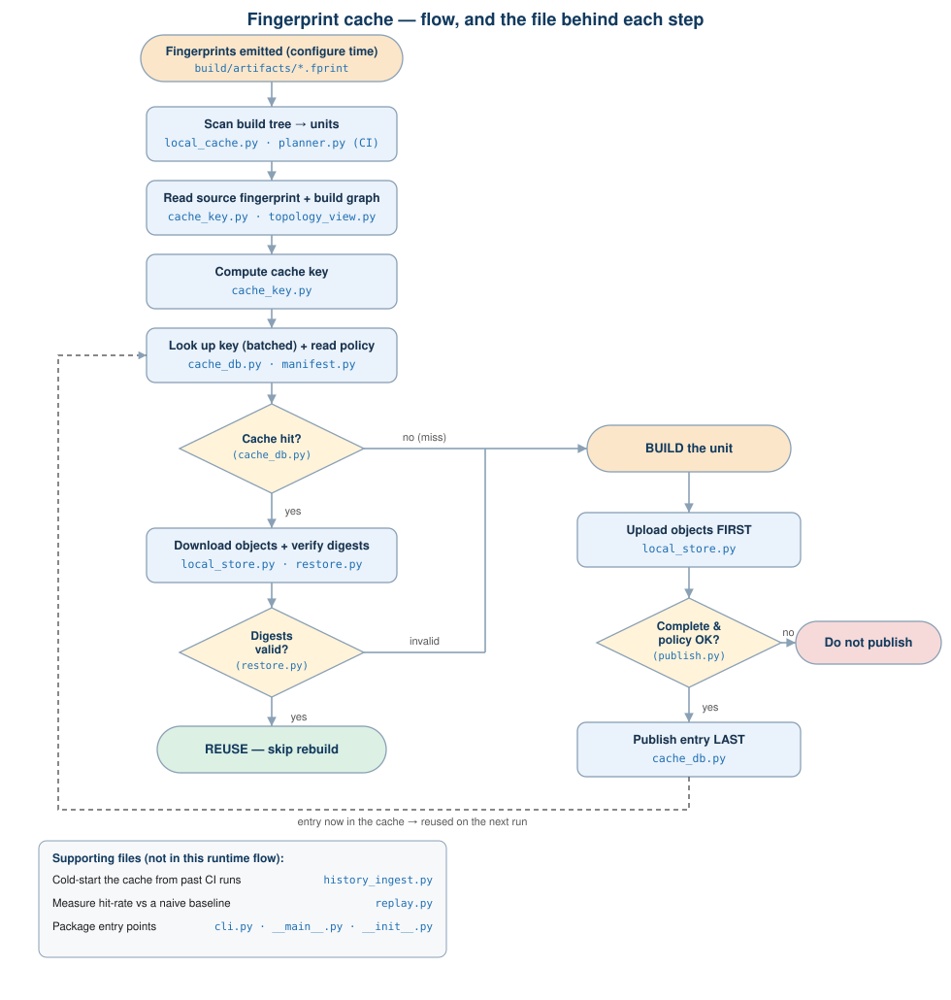

# Fingerprint-Based CI Artifact Cache

This RFC proposes caching CI build artifacts by content, keyed on the
`THEROCK_FPRINT` that CMake already computes for each artifact. A run computes
the fingerprint of every artifact it would build, looks those fingerprints up in
a shared database in one query, and downloads the matching prebuilt artifacts
instead of rebuilding them. This replaces the "baseline run" stage-reuse
mechanism, which picks a prior run by commit ancestry and S3-filename presence
rather than by what the sources actually produce. Tracks
[#8651](https://github.com/ROCm/TheRock/issues/8651).

## Problem

Reuse today walks workflow history to find a baseline run, then trusts it based on
commit ancestry, S3 archive filenames, and job health
(`baseline_runs.py`, `stage_reuse_decision.py`). Fingerprints are never
consulted. This is O(N) over runs, spends a lot of GitHub API calls, can't express
rocm-libraries → rocm-libraries dependencies or arbitrary build-graph subsets, and
is brittle on release branches ([#8454](https://github.com/ROCm/TheRock/issues/8454)).

`THEROCK_FPRINT` already hashes the inputs that determine an artifact's output —
its sources, its dependencies' fingerprints, the toolchain, and the build flags.
If two builds compute the same fingerprint, they would produce the same artifact,
so we can reuse it. That makes the fingerprint the natural cache key and removes
the history walk entirely.

## Goals

- Look reuse up by content in one batched query, independent of run history.
- Reuse unchanged artifacts across pin bumps and component commits; rebuild only
  what actually changed.
- Verify every reused object; anything missing or unverifiable falls back to a
  build.
- Compose with [RFC0013](./RFC0013-Consumer-Based-Test-Selection.md) — a cache
  hit never suppresses a test.

## Non-goals

- Test selection — that stays in RFC0013.
- Replacing `ccache`, which caches compiler calls; this caches whole artifacts
  and stacks on top of it.
- New object storage — artifacts already live in the `ci-artifacts` S3 buckets;
  the cache stores pointers, not copies.

## Design

### The key

The key is the artifact's source fingerprint plus the recipe inputs and output
identity, under a global epoch we can bump to invalidate everything at once:

```text
cache_key = e{CACHE_EPOCH}:SHA256(source_fingerprint, recipe_inputs, output_identity)
```

Most of what the key needs is already inside `THEROCK_FPRINT`:

| Input                                                                               | In `THEROCK_FPRINT`? | Notes                                                            |
| ----------------------------------------------------------------------------------- | -------------------- | ---------------------------------------------------------------- |
| Source identity (project-scoped Git tree + declared extra inputs; invalid if dirty) | yes                  | see below                                                        |
| Dependency fingerprints                                                             | yes                  | a dependency change propagates to its consumers                  |
| Toolchain file                                                                      | yes                  |                                                                  |
| Build flags (including the variant, e.g. release vs. ASan)                          | yes                  | already folded in, so the variant is not a separate key term     |
| Output identity (`name`, `component`, `target`)                                     | partial              | needed only until split artifacts fingerprint per target (below) |
| Container image digest                                                              | no                   | add, so a different build image invalidates                      |
| Compiler id + version                                                               | indirect             | add explicitly                                                   |

A note on **targets vs. target families**: multi-arch CI builds a *family* like
`gfx110X-all`, which expands to the *targets* `gfx1100`–`gfx1103`, and split
artifacts are named per target (`fft_lib_gfx1100.tar.zst`). So the key has to
distinguish targets, not families. This is only load-bearing while every target
of a split artifact shares one fingerprint; once split artifacts emit a `.fprint`
per target, the fingerprint already differs per target and this term goes away.

### Fingerprint computation and stability

The fingerprint is only useful if a fresh build reproduces it. Source identity is
scoped to a subproject's Git tree plus declared extra inputs
([#9907](https://github.com/ROCm/TheRock/pull/9907)), so a repo-wide commit
doesn't invalidate a subproject whose own sources didn't change, and a dirty tree
produces an invalid fingerprint that is never cached.

The failure to avoid is a *false hit* — reusing an artifact that should have been
rebuilt — which can only happen if the fingerprint misses a real input. A
*false miss* (a fingerprint that doesn't reproduce) is merely wasteful. So
fingerprint stability gates the whole feature, and we track it under #8651: MLIR
reconfiguration stability ([#9936](https://github.com/ROCm/TheRock/pull/9936))
and the hipcc changelog timestamp
([llvm-project#5411](https://github.com/ROCm/llvm-project/pull/5411)) are fixed;
hipcc fresh-build reproducibility is the open item.

### The value

The database maps a key to the objects that make up the artifact, plus enough
provenance to debug a reuse:

```text
cache_key -> {
  artifact:   (name, component, target)
  outputs:    [ {object_key, s3_uri, sha256, size_bytes} ]
  provenance: {repository, run_id, commit, created_at}
}
```

That's deliberately all of it. We don't store trust, validation, or publication
state: only trusted runs (push/scheduled on a protected branch) write to the
cache, so a PR can't poison it without us recording a "trust" flag; whether tests
passed is irrelevant to a build cache; and a key existing in the database is what
"published" means.

### Flows



- **Plan** (per run): from the changed paths, compute the fingerprint of each
  artifact the run would build and look them all up in one query. Changed
  artifacts are forced misses. Hits are reuse candidates; misses get built.
- **Restore** (per hit): download the objects and re-verify their SHA-256
  digests. A missing object or a digest mismatch demotes the hit to a build, so
  storage drift can never hand back a wrong artifact.
- **Publish** (per built artifact, trusted runs only): upload the objects, then
  write the entry.

### The database

Objects stay in the S3 buckets; the index stores pointers and tolerates objects
being retention-deleted (a dangling entry just falls back to a build).

The index needs to be a **server-side database** that is written as artifacts are
uploaded and can be rebuilt from a cold start by backfilling from S3 or replaying
run history. A file checked into Git is fine for an early proof of concept but
won't scale: a real cache writes an entry per artifact per trusted run, which is
far too many commits for a Git repo (Quartz is already ~60k commits). We put a
small `lookup(fingerprints)` / `publish(entries)` interface in front of it so the
first LLVM-only prototype can use a checked-in JSON
([#10026](https://github.com/ROCm/TheRock/pull/10026)) and switch to the
server-side store without touching callers. Fingerprints are already uploaded
next to their artifacts ([#9921](https://github.com/ROCm/TheRock/pull/9921)), so
populating the database just records existing sidecars.

### Using it

Reuse is driven by small scripts over the database, in the spirit of the existing
[`find_latest_artifacts.py`](https://github.com/ROCm/TheRock/blob/main/build_tools/find_latest_artifacts.py):
one that asks the database which artifacts match the current sources, and a
bootstrap script that fetches them and marks their stages prebuilt. CI runs these
in its build-planning step; a developer can run the same scripts to start a local
build from cached artifacts. There is no cache on/off switch in the build system
itself — this is a CI feature plus opt-in scripts.

## Controlling reuse

- CI picks a **reuse mode**: `off` (build everything), `dry-run` (compute and
  report the plan but still build — how we validate predictions before trusting
  them), or `on`.
- **Release builds** build everything from source and don't read the cache. This
  is a normal mode we run regularly, not a kill switch.
- **`CACHE_EPOCH`** is the one global lever: bump it to invalidate every key, for
  a schema change or an environment change the fingerprint doesn't capture.

Per-entry controls — ignoring a specific hit, revoking a bad entry — are left as
future ideas; we don't need them to start.

## What we measured

A benchmark harness drove a real `gfx110X-all` build against a real database:

- **Reuse works and tracks the dependency graph.** An unchanged rebuild is a 100%
  hit. Changing a leaf tool (`compiler/hipify`) invalidates 2 artifacts; changing
  the compiler (`compiler/amd-llvm`) invalidates its whole downstream cone, 132 of
  206 — which is correct, since everything builds with it.
- **The big gap is split artifacts.** Of 349 artifacts, 206 are cacheable and
  143 (~41%) are not: the per-target split artifacts emit no `.fprint`
  (`if(NOT _should_split)` in `cmake/therock_artifacts.cmake`), and that set
  includes the expensive libraries (`blas`, `fft`, `composable-kernel`,
  `hipkernelprovider`). Fingerprinting them is the largest win on the table.
- **The payoff is real.** On a full run the cold build took ~100 min and an
  unchanged warm rerun ~3 s.

Two caveats on these numbers: the per-component rows perturb a non-compiled file,
so they measure invalidation scope rather than rebuild time; and lookups ran from
the build host to an external ClickHouse Cloud instance (~100 ms per query), an
upper bound that an in-region database would beat.

## What this needs

1. Emit a `.fprint` for split (Kpack, [RFC0008](./RFC0008-Multi-Arch-Packaging.md))
   artifacts. Biggest reuse unlock, and it also retires the per-target key term.
1. Add the container image digest and explicit compiler id+version to the key,
   then freeze the composition under `CACHE_EPOCH`.
1. Stand up the server-side database with populate-on-upload and cold-start
   backfill.

## Plan

Start where a wrong reuse is cheapest to catch and the savings are largest — the
compiler — and widen only as each stage proves out, following the staged rollout
from when fingerprints were first added
([#2432](https://github.com/ROCm/TheRock/pull/2432)). Each step is gated on
evidence that a false hit can't happen before the next begins.

1. **Reproducible fingerprints** (gating, in progress): MLIR stability fixed
   (#9936), source scoping landed (#9907), hipcc reproducibility open.
1. **Fingerprints available** (landed): emit and upload `.fprint` next to each
   archive (#9921). Additive; nothing consumes them yet.
1. **LLVM index + lookup** (in review): a database of known-good `amd-llvm`
   producers and a lookup that turns a build's fingerprints into a hit/miss plan
   (#10026). Read-only.
1. **Populate from cache**: download the matched `amd-llvm` artifact, verify
   checksums, place it.
1. **Reuse LLVM in multi-arch CI**: consume the plan to skip the compiler stage,
   `dry-run` first with the baseline path as fallback, then on.
1. **Widen and retire the legacy path**: more base libraries, then dependent
   stages; move to the server-side database; drop the `baseline_runs.py` checks
   and the "Copy Prebuilt Stages" path in `multi_arch_ci_linux.yml` once at parity.

## Test scenarios

| Scenario                         | Expected                                              |
| -------------------------------- | ----------------------------------------------------- |
| Rebuild, no changes              | 100% reuse                                            |
| Committed edit of one subproject | that artifact and its consumers rebuild, nothing else |
| Dirty (uncommitted) tree         | fingerprint invalid; not cached                       |
| Compiler/toolchain change        | the downstream cone rebuilds                          |
| Container image change           | invalidation (once the digest is in the key)          |
| Split/per-arch artifact          | uncacheable today; closed by this RFC                 |
| Same source, different build dir | same key                                              |
| PR (untrusted) run               | reads the cache, never writes it                      |
| Object missing / digest mismatch | builds, no failure                                    |

## Alternatives

- **Keep extending the baseline-run search** — O(N), API-heavy, can't express
  arbitrary subsets, brittle on release branches.
- **Map a key to a single S3 URL** instead of an object set with digests — loses
  per-object verification and multi-object artifacts.
- **Check the index into Git for production** — the write volume makes this
  unworkable; it's only for the first prototype.
