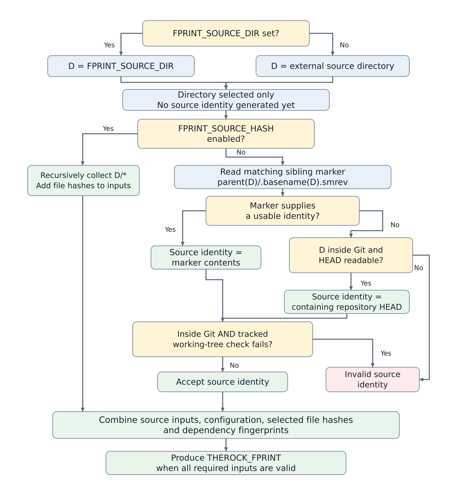
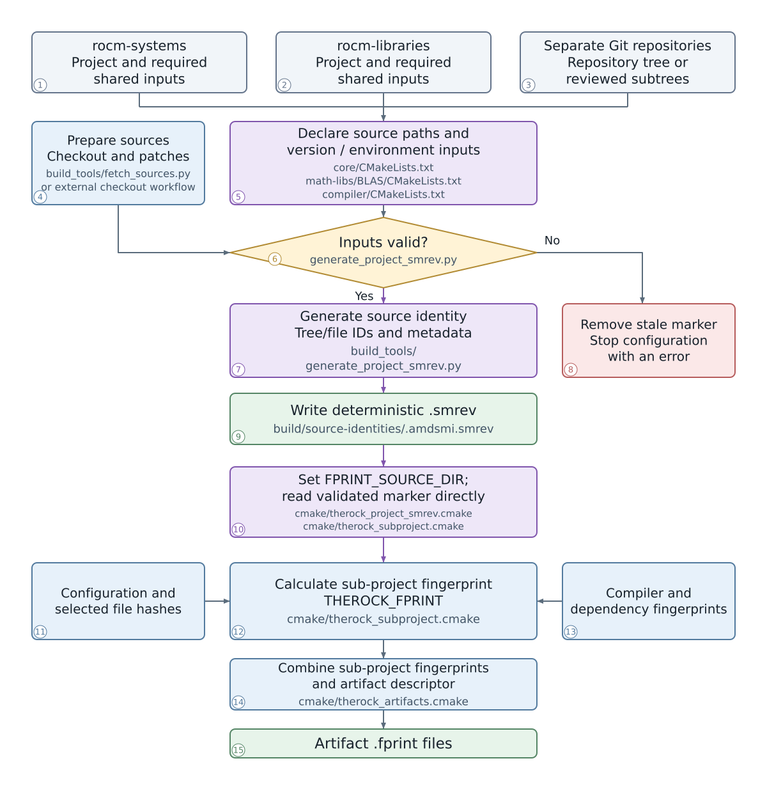

# Project-scoped source identities for artifact fingerprinting

## Overview

This RFC proposes generating a source-identity marker (`.smrev`) for each
participating sub-project from its prepared source contents and declared shared,
version, and environment inputs. Existing configuration and dependency
fingerprinting continues to produce sub-project and artifact fingerprints.

An opt-in prototype exists. The proposal covers `rocm-systems`,
`rocm-libraries`, and selected separate Git repositories on native Linux.

## Motivation

When no suitable `.smrev` is available, the existing Git reader uses the
containing repository's `HEAD` commit. In a monorepo, committing an AMD SMI change updates the repository’s HEAD, which can change other sub-projects’ source identities even when their files are unchanged. Those changes can propagate through dependencies and cause
unnecessary cache misses.

The existing source-preparation code can write a repository-level marker such as
`TheRock/.rocm-systems.smrev`. AMD SMI's default lookup instead checks
`TheRock/rocm-systems/projects/.amdsmi.smrev`. The repository-level marker does
not satisfy that lookup, and using its whole-repository revision would still
invalidate unrelated sub-projects.

A project directory's Git tree ID provides a narrower identity:

```bash
git -C rocm-systems rev-parse HEAD:projects/amdsmi
```

Unlike the repository commit ID, this ID stays unchanged across commits that
leave the directory's contents and recorded file modes unchanged. Required
inputs outside that directory must also be represented.

### Current source-identity selection

**Figure 1. Current default path in `cmake/therock_subproject.cmake`.**



`FPRINT_SOURCE_DIR` selects a directory; it does not generate a marker.
The tracked-file check is `git diff --quiet --ignore-submodules HEAD`. It also
applies to marker-derived identities when D is inside Git. Source hashing
bypasses the marker/Git reader. `FPRINT_FILE_GLOBS` adds file hashes to the final
calculation. Figure 2 adds the project-scoped route; this default path remains
for other sub-projects.

## Goals and scope

The source identity must change when a declared relevant input changes and
remain stable across unrelated commits when all relevant inputs remain equal.
Dependency fingerprint propagation must remain intact.

| Sources                   | Proposed source scope                                                             | Example                                                                                                                                                                                                                                                                                                                                                                                       |
| ------------------------- | --------------------------------------------------------------------------------- | --------------------------------------------------------------------------------------------------------------------------------------------------------------------------------------------------------------------------------------------------------------------------------------------------------------------------------------------------------------------------------------------- |
| `rocm-systems`            | Sub-project directory plus required shared sources, generators, and build helpers | `rocm-systems/projects/amdsmi`, `rocm-systems/shared/cuid`, and `rocm-systems/shared/sha256`                                                                                                                                                                                                                                                                                                  |
| `rocm-libraries`          | Sub-project directory plus required shared sources, generators, and build helpers | `rocm-libraries/projects/rocblas` and its required `rocm-libraries/shared/tensile` inputs                                                                                                                                                                                                                                                                                                     |
| Separate Git repositories | Complete tracked repository tree initially; narrower scopes require review        | **5 repositories, 7 sub-projects:**<br>**Sub-project — CMake source directory relative to TheRock/**<br>• `rocm-cmake` — `base/rocm-cmake`<br>• `rocm-half` — `base/half`<br>• `amd-llvm` — `compiler/amd-llvm/llvm`<br>• `amd-comgr` — `compiler/amd-llvm/amd/comgr`<br>• `hipcc` — `compiler/amd-llvm/amd/hipcc`<br>• `hipify` — `compiler/hipify`<br>• `libhipcxx` — `math-libs/libhipcxx` |

Both monorepos can contain shared source code and generators. Their difference
is the repository and declared paths, not the identity algorithm.

In the separate Git repositories row, the listed paths are CMake source
directories, not necessarily fingerprint scopes. For example, LLVM configures
from `compiler/amd-llvm/llvm`, while the proposed initial source identity covers
the complete `compiler/amd-llvm` checkout.

Fetched dependencies retain their existing fetch-recipe markers. Other source
handling remains unchanged. Cache storage, restoration, CI reuse, split-artifact
fingerprint coverage, and build-path normalization are outside this RFC.

## Technical design

### Declare inputs beside each sub-project

Each participating sub-project declares its inputs in its existing
`CMakeLists.txt`. There is no separate manually maintained JSON catalog.

This abbreviated AMD SMI declaration shows source selection:

```cmake
therock_cmake_subproject_declare(amdsmi
  EXTERNAL_SOURCE_DIR "${THEROCK_ROCM_SYSTEMS_SOURCE_DIR}/projects/amdsmi"
  FPRINT_PROJECT_SOURCE
  FPRINT_PROJECT_INPUTS "shared/cuid" "shared/sha256"
  # Version, environment, and existing build arguments follow.
)
```

`EXTERNAL_SOURCE_DIR` supplies the default source scope. Additional declarations
cover required or optional shared paths, version queries, and relevant
environment variables. A scope override supports a parent directory or complete
repository tree.

Declarations must reflect inputs actually consumed by configuration, build,
installation, or packaging. An unset environment value alone is not a reason to
remove the variable; unset, empty, and populated values are distinct. External
tool paths alone do not identify the installed tool contents.

### Generate and read a validated marker

**Figure 2. Proposed source-identity generation and fingerprint integration.**

This route applies when `THEROCK_PROJECT_SMREV=ON` to participating
`FPRINT_PROJECT_SOURCE` declarations.



**Color key:** **purple** = proposed steps; **blue** = existing processing;
**green** = outputs; **yellow** = checks; **red** = failure; **gray** = source
repositories. All boxes use dark text. Numbers identify Figure 2's steps, and
file names identify the responsible implementation.

The numbers below match Figure 2. Step 8 describes the required failure
behavior; the remaining early-error cleanup gap is listed under Validation
and implementation status. Steps 11 and 13 supply inputs to step 12.

1. **Select rocm-systems inputs.** Include each sub-project’s source directory
   and required shared sources, generators, and build helpers.

1. **Select rocm-libraries inputs.** Apply the same approach, with the source
   and shared paths declared for each library.

1. **Select separate Git repository inputs.** Start with the complete tracked
   repository tree. Narrower scopes require review to ensure all required
   inputs remain covered.

1. **Prepare sources.** Complete checkout and apply required patches before
   generating source identities.

1. **Declare inputs.** Each participating sub-project’s `CMakeLists.txt`
   declares its source scope, shared paths, version inputs, and relevant
   environment variables.

1. **Validate the actual sources.** Before trusting committed tree/blob IDs,
   reject tracked modifications, relevant untracked sources, missing required
   inputs, and unsupported or inconsistent nested checkouts.

1. **Generate the source identity.** Resolve the declared directory tree IDs
   and file blob IDs from a fixed revision, and include the declared version
   and environment values. Do not use the enclosing repository’s commit ID
   as the general source identity.

1. **Handle validation or generation failure.** Remove any stale marker owned
   by the generator and stop configuration with an error. Do not silently
   fall back to repository `HEAD` or consume an old marker.

1. **Write the marker.** Serialize the identity deterministically and write
   it atomically under `build/source-identities/`. Preserve its timestamp
   when its contents are unchanged.

1. **Read the validated marker.** Record the marker lookup directory in
   `FPRINT_SOURCE_DIR` and read the exact generated marker directly after
   validation. The default reader remains unchanged for other routes.
   This avoids checking TheRock’s Git state around the build directory
   instead of validating the actual source repository.

1. **Include configuration and selected file hashes.** Retain the existing
   build settings and file inputs used by the fingerprint calculation,
   including additions declared through `FPRINT_FILE_GLOBS`.

1. **Calculate the sub-project fingerprint.** Combine the source identity,
   configuration, selected file hashes, and dependency fingerprints.
   Store the result in `THEROCK_FPRINT` when all required inputs are valid.

1. **Include compiler and dependency fingerprints.** Retain the configured
   compiler, build, and runtime dependency inputs. A dependency change can
   therefore invalidate a sub-project even when its own sources are unchanged.

1. **Calculate the artifact fingerprint.** Combine the fingerprints of every
   contributing sub-project with the artifact descriptor inputs.

1. **Write artifact fingerprint files.** Emit `.fprint` files for supported
   artifact outputs. These contain the resulting artifact fingerprints;
   `.smrev` files supply source identities earlier in the calculation.

#### Example AMD SMI source-identity marker

This abbreviated example shows the marker structure. Object IDs are
placeholders; generated markers contain actual Git object IDs. Additional
declared source and environment inputs are omitted for readability.

```json
{
  "environment": {
    "ROCM_BUILD_ID": null,
    "ROCM_LIBPATCH_VERSION": null
  },
  "environment_patterns": [],
  "inputs": [
    {
      "mode": "040000",
      "object_id": "<amdsmi-tree-id>",
      "path": "projects/amdsmi",
      "type": "tree"
    },
    {
      "mode": "040000",
      "object_id": "<cuid-tree-id>",
      "path": "shared/cuid",
      "type": "tree"
    },
    {
      "mode": "040000",
      "object_id": "<sha256-tree-id>",
      "path": "shared/sha256",
      "type": "tree"
    }
  ],
  "nested_sources": [],
  "repository": "rocm-systems",
  "schema": "therock-project-smrev-v2",
  "version_inputs": [
    {
      "query": {
        "kind": "latest",
        "pattern": "amdsmi_pkg_ver*"
      },
      "value": null
    },
    {
      "query": {
        "kind": "latest",
        "pattern": "rsmi_so_ver*"
      },
      "value": null
    }
  ],
  "version_policy": "retain-producer-provenance-v1"
}
```

#### Explanation of the marker fields

The marker records the declared source and metadata inputs for a sub-project.
It supplies the source identity used in fingerprint calculation.

| Field                               | Meaning                                                                                                                                                                                                                      |
| ----------------------------------- | ---------------------------------------------------------------------------------------------------------------------------------------------------------------------------------------------------------------------------- |
| `schema`                            | Identifies the marker format. `therock-project-smrev-v2` distinguishes this structure from other formats.                                                                                                                    |
| `repository`                        | Identifies the source repository, such as `rocm-systems`. This is a repository name, not its current commit ID.                                                                                                              |
| `inputs`                            | Lists the project source directory and required shared files or directories. For AMD SMI, the example includes `projects/amdsmi`, `shared/cuid`, and `shared/sha256`.                                                        |
| `inputs[].path`                     | Source path relative to the source repository root. For example, `projects/amdsmi` is inside `rocm-systems`.                                                                                                                 |
| `inputs[].type`                     | Git object type: `tree` for a directory or `blob` for a file. An optional input that is missing is recorded as `absent`.                                                                                                     |
| `inputs[].mode`                     | Git entry mode. `040000` identifies a directory; file modes distinguish ordinary files, executable files, and symbolic links.                                                                                                |
| `inputs[].object_id`                | Git object ID for the selected directory or file. A directory tree ID represents its tracked contents and structure, so unrelated repository commits do not change it.                                                       |
| `environment`                       | Records the declared environment variables and their values when the marker is generated.                                                                                                                                    |
| `environment.ROCM_BUILD_ID`         | Build identifier used by AMD SMI when constructing its reported package-version string.                                                                                                                                      |
| `environment.ROCM_LIBPATCH_VERSION` | Additional version suffix used by AMD SMI for CPack packaging.                                                                                                                                                               |
| `environment_patterns`              | Regular-expression rules for selecting additional environment-variable names. An empty list means no additional variables are selected through patterns. Explicitly named variables are still recorded.                      |
| `nested_sources`                    | Records nested Git submodule checkouts within the selected source scope, including their recorded state. An empty list means none were recorded for that scope.                                                              |
| `version_inputs`                    | Records the declared Git version queries and their results, allowing relevant version metadata to participate in the source identity.                                                                                        |
| `version_inputs[].query.kind`       | Selects the query operation. In this example, `latest` selects the highest matching tag using Git's version-name ordering, not its creation date.                                                                            |
| `version_inputs[].query.pattern`    | Restricts the query to matching tag names, such as `amdsmi_pkg_ver*` or `rsmi_so_ver*`.                                                                                                                                      |
| `version_inputs[].value`            | Result of the query. For a `latest` query, this is the selected tag name, or `null` when no matching tag exists.                                                                                                             |
| `version_policy`                    | Names the policy for Git-derived producer metadata. `retain-producer-provenance-v1` allows reused artifacts to retain their original producer's commit metadata. It does not rewrite that metadata to the consumer's commit. |

**Meaning of `null`:** In `environment`, it means the variable was unset.
The sub-project may then use its own default. In a `latest` version query,
it means no matching tag was found. Neither case automatically indicates
an error.

**Relationship to the final fingerprint:** The marker is one input.
Existing configuration, selected-file hashes, and dependency fingerprints
still contribute to the sub-project fingerprint. Artifact fingerprinting
then combines all contributing sub-project fingerprints and the artifact
descriptor.

**Build-time freshness checks:** Generated request files record the configured
source-identity inputs. Revalidate those inputs before and after build/stage
operations, and stop the operation if they change so outputs cannot be accepted
under a stale identity. Marker existence alone does not establish freshness.

`FPRINT_SOURCE_DIR` alone selects an identity lookup directory; it does not
generate or validate a project-scoped identity. The new helper performs those
operations and returns the validated marker path.

### Version metadata and compatibility

The proposed policy permits restored artifacts to retain their original
producer's commit, branch, or build-count labels. Restoration does not rewrite
those labels, and producer provenance remains available.

This policy does **not** promise byte-identical embedded metadata when rebuilding
equivalent sources at another commit. Release versions and any Git-derived
values that affect required behavior or compatibility must remain inputs.
Sub-projects that require current-commit labels need a stricter policy.

Existing source-preparation markers, including LLVM's repository/revision
marker, remain separate and unchanged.

### Implementation responsibilities

| File                                        | Responsibility                                                          |
| ------------------------------------------- | ----------------------------------------------------------------------- |
| Existing sub-project `CMakeLists.txt` files | Declare source, shared, version, and environment inputs                 |
| `build_tools/generate_project_smrev.py`     | Validate inputs, resolve identities, write markers, and check freshness |
| `cmake/therock_project_smrev.cmake`         | Pass declarations to the generator and register identity checks         |
| `cmake/therock_subproject.cmake`            | Read validated markers and retain existing fingerprint calculation      |
| `cmake/therock_artifacts.cmake`             | Existing aggregation of contributing sub-project fingerprints           |
| `build_tools/tests/project_smrev_test.py`   | Test generation, validation, and CMake integration                      |

## Validation and implementation status in local development

The prototype is enabled with `THEROCK_PROJECT_SMREV=ON`; it defaults to
`OFF`. The current configured experiment covered 72 sub-project markers.

| Check                                          | Observed result                                                                                                                 |
| ---------------------------------------------- | ------------------------------------------------------------------------------------------------------------------------------- |
| Unchanged configuration                        | All 72 markers and 186 artifact fingerprints stayed identical                                                                   |
| Committed AMD SMI edit                         | Only its source marker changed; 34 artifact fingerprints changed and 152 stayed identical; base and LLVM controls stayed stable |
| Repeat after edit and restore original sources | Repeat stayed stable; restoration recovered the baseline markers and fingerprints                                               |

These configure-time experiments demonstrate narrower invalidation. They do not
prove that every declaration is complete, that a consumer reused cached outputs,
or that compilation was avoided.

Before enabling broader use:

- Validate shared-input, configuration, version/environment, unrelated-commit,
  and invalid-source cases across the supported repositories.
- Finish the input audit, including effective installation environment and
  external tool contents. Mutable external inputs must remain uncacheable until
  represented; the prototype currently excludes `profiler-hub` and `mirage`
  from valid final fingerprints for this reason.
- Complete stale-marker cleanup for every error path, including CMake failures
  before the Python generator starts.
- Verify marker stability across equivalent checkout/build locations; validate
  full fingerprint portability alongside the separate path-normalization work.
- Measure configuration overhead and demonstrate consumption in a separate
  cache-reuse experiment.

## Open questions

1. Is retaining original producer version metadata acceptable for each supported
   sub-project and release workflow?
1. Which shared, optional, and environment inputs are necessary for each
   supported configuration, and who maintains those declarations?
1. What validation and performance evidence is required before enabling this
   behavior by default?

## References

- [Artifact fingerprint cache design issue #8651](https://github.com/ROCm/TheRock/issues/8651)
- [Original fingerprint implementation #2432](https://github.com/ROCm/TheRock/pull/2432)
- [Related build-path normalization work #9060](https://github.com/ROCm/TheRock/pull/9060)
